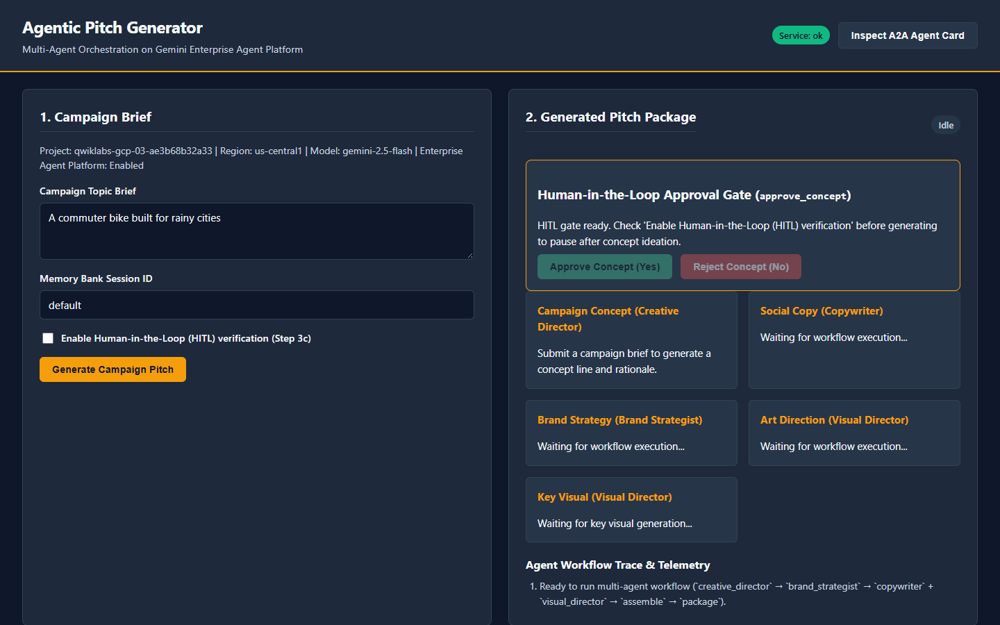
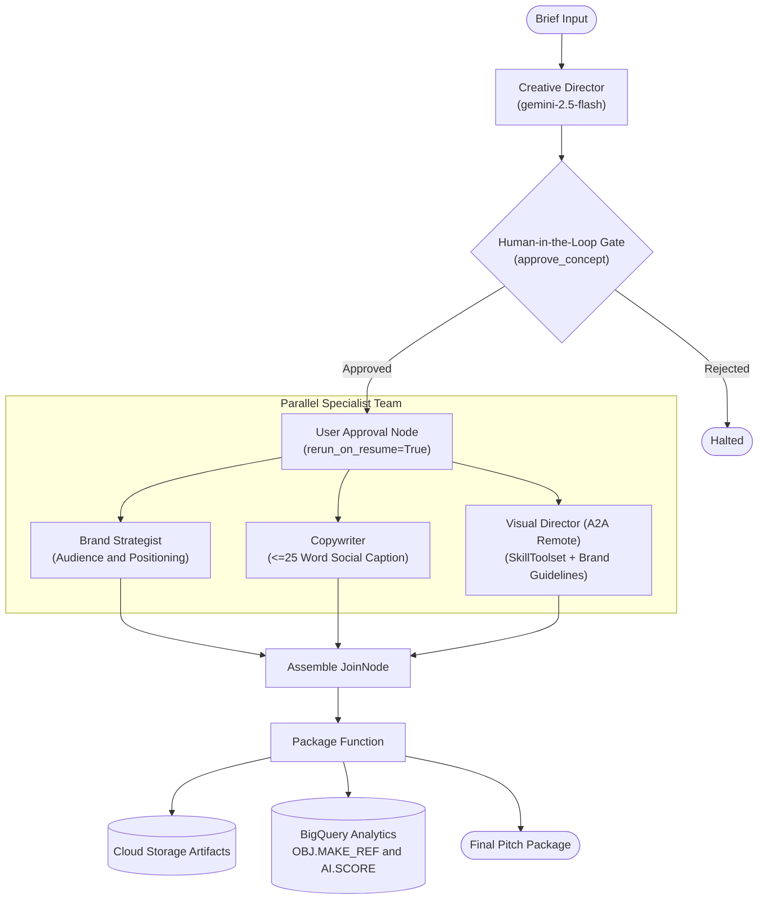

# 🚀 Agentic Pitch Generator: Enterprise Multi-Agent System

An enterprise-grade multi-agent campaign pitch generation platform built on the **Google Agent Development Kit (ADK)** and **Gemini Enterprise Agent Platform (GEAP)**. It orchestrates specialized AI agents (Creative Director, Brand Strategist, Copywriter, and Visual Director) to transform campaign briefs into complete pitch packages with automated brand compliance, multimodal analytics, and tokenomics optimization.

<div align="center">
  <br/>
  
  <br/>
</div>

---

## 🏛️ System Architecture



---

## 📦 Progressive Engineering Modules

### 🎨 Module 1: Dynamic ADK Skills & Remote A2A Architecture
- **Skill Authoring (`SKILL.md`)**: Dynamic YAML-frontmatter guidelines defining house visual rules (`Palette`, `Light`, `Composition`, `Subject`, `Never`).
- **Deterministic Evals (`evaluate_brand_skill`)**: Automated regex and semantic benchmark scoring rejecting anti-patterns (no CGI slop, neon, or watermarks).
- **Remote A2A Microservice**: Decoupled `visual_director` into an autonomous Cloud Run service communicating over A2A JSON-RPC with `AgentCardBuilder`.

### 📊 Module 2: Multimodal BigQuery Analytics & Closed-Loop Tuning
- **Object Tables (`OBJ.MAKE_REF`)**: DDL registering generated visual artifacts directly from Cloud Storage without duplicating raw image binaries.
- **Brand Drift Detection (`AI.SCORE`)**: Multimodal SQL analytics evaluating visual brand compliance and triggering automated prompt re-tuning when scores drift.

### 🛡️ Module 3: Enterprise Security & Human-in-the-Loop (HITL)
- **PreToolUse Lifecycle Hooks**: Intercepts tool calls before execution to enforce strict allowlists and prevent path traversal (`../../`) or prompt injection.
- **PII Scrubber**: High-throughput regex engine redacting emails, credit cards, SSNs, phone numbers, and secrets (`[REDACTED_*]`).
- **ADK HITL Review Gate (`approve_concept`)**: Uses `@node(rerun_on_resume=False)` to pause execution with `input_required` for human sign-off before committing image generation compute.

### ⚡ Module 4: Tokenomics & Context Window Optimization
- **Context Pruning & Summarization (`compress_memory`, `prune_history`)**: Rolling memory bank maintaining token budgets.
- **Prompt Cache Manager**: Deterministic TTL caching for system instructions and brand guidelines to reduce LLM input latency and costs.
- **Dynamic Model Strategy Routing**: Tiered routing (`economy`, `balanced`, `quality`) adapting model selection to prompt complexity.

---

## 🚀 Quickstart

### 1. Installation
```bash
pip install -e .
```

### 2. Configure Environment
```bash
cp .env.example .env
# Set your GCP Project ID and Vertex AI credentials
```

### 3. Launch Services Locally
```bash
# Terminal 1: Launch Visual Director A2A Microservice
export SERVICE_ROLE="visual-director"
export PORT=8801
python pitch_generator/fast_api_app.py

# Terminal 2: Launch Main Pitch Generator Web App
export PORT=8085
python pitch_generator/fast_api_app.py
```
Open **`http://localhost:8085`** in your browser.

### 4. Run Test Suite
```bash
python -m pytest tests/test_module_1.py tests/test_module_2.py tests/test_module_3.py tests/test_module_4.py -v
```

---

## 📄 License
Apache License 2.0. Built with Google Cloud & Gemini Enterprise Agent Platform.
